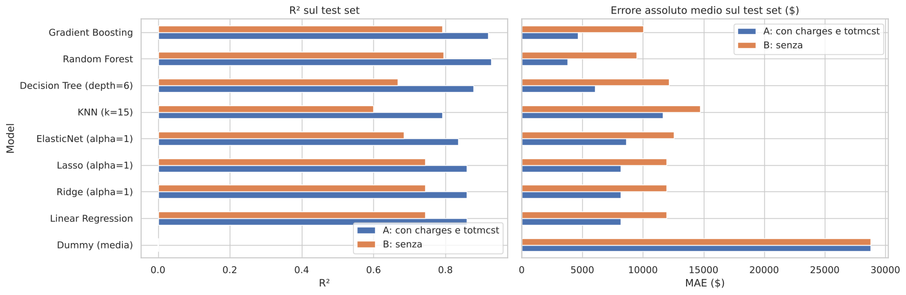
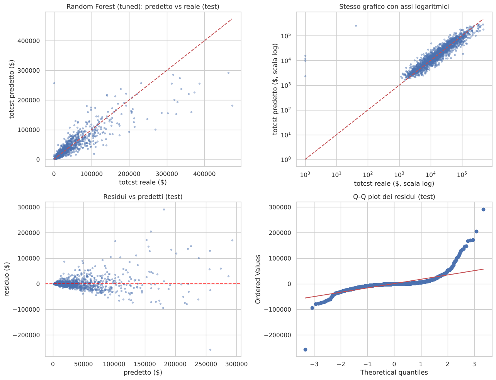
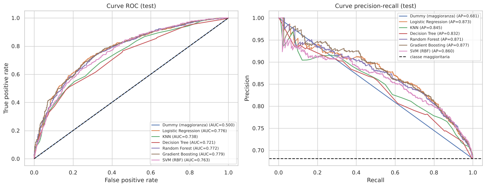
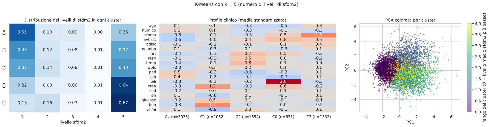

# SUPPORT2: cost regression, mortality classification and clustering on critically ill patients

An end-to-end machine learning study of the **SUPPORT2** clinical dataset (9,105 critically ill hospitalized adults, 5 US hospitals, 1989–1994). The project covers exploratory analysis, regression, classification and clustering, with a strong focus on **avoiding data leakage**, **honest evaluation** and **reporting negative results**.

Built for the Machine Learning course at Politecnico di Milano (2025). The notebook text and figure labels are in Italian; this README is in English.

> **Everything is in one notebook:** [`notebooks/support2_analysis.ipynb`](notebooks/support2_analysis.ipynb) (already executed, so results are visible on GitHub without running anything).

## The three tasks

| Task | Target | Data used | Best model | Headline result (held-out test set) |
|---|---|---|---|---|
| Regression | `totcst` (total hospital cost, $) | 8,217 patients with observed cost | Random Forest (tuned) | R² = 0.785, MAE ≈ $9.6k (mean-predictor baseline: R² ≈ 0) |
| Classification | death before end of 1994 | 9,105 patients (68.1% died) | Gradient Boosting (tuned) | ROC-AUC = 0.779, PR-AUC = 0.877 (majority baseline: 0.500 / 0.681) |
| Clustering | ordinal functional outcome `sfdm2` (used only as external reference) | 7,705 patients with `sfdm2` | K-Means, k = 5 | Silhouette = 0.08, NMI = 0.055: **weak structure** |



## What I did

### 1. Exploratory analysis and preprocessing
- Missing-value analysis, correlation heatmap, class balance, skewness checks.
- Domain-informed imputation: published "normal" fill-in values for physiological variables (albumin, bilirubin, creatinine, BUN, PaO2/FiO2, WBC, urine output) and an explicit `missing` category for categorical fields.
- All remaining imputation (median), scaling and one-hot encoding live inside scikit-learn `Pipeline` + `ColumnTransformer` objects, **fit on training folds only**.
- Train/test split done once, stratified for classification; test set touched only for final evaluation.

### 2. Regression on total hospital cost
- Compared **9 models**: dummy baseline, Linear, Ridge, Lasso, ElasticNet, KNN, Decision Tree, Random Forest, Gradient Boosting; hyperparameters tuned with cross-validated grid search.
- **Two scenarios**, to make leakage visible:
  - *A*: including `charges` and `totmcst` (alternative measures of the same cost). Random Forest reaches test R² = 0.927, but the model is mostly re-reading the target.
  - *B* (the one I report): those columns removed. Linear models reach R² ≈ 0.744, tuned Random Forest 0.785.
- Raw vs log-transformed target compared empirically: log-target linear regression produced absurd dollar predictions after back-transformation (max prediction ≈ 190M $ vs real max 473k $), so the raw target was kept.
- Feature selection: **forward selection with the one-standard-error rule** (3 features: `slos`, `hday`, `avtisst`; test R² = 0.722, only ~0.06 below the best model) and Lasso (42 of 53 features kept).
- Interpretation: permutation importance (`slos` ≈ 78%) and a hand-computed OLS table (coefficients, standard errors, t, p, F) for the 3-feature model, with effects converted back to dollars per original unit.
- Residual diagnostics: predicted vs actual, residuals vs predicted (heteroscedasticity), Q–Q plot (heavy right tail).



### 3. Classification of in-hospital and post-discharge death
- Compared 7 models (dummy, Logistic Regression, KNN, Decision Tree, Random Forest, Gradient Boosting, SVM-RBF) using **metrics suited to class imbalance**: ROC-AUC, PR-AUC, balanced accuracy, precision/recall/F1, confusion matrices. Plain accuracy is reported only next to the 68.1% "always dead" baseline.
- Decision threshold chosen with **Youden's J on out-of-fold training predictions** (never on the test set): balanced accuracy goes from 0.656 to 0.705, trading recall (0.89 → 0.63) for precision (0.77 → 0.86).
- **Leakage demonstration** (cross-validated ROC-AUC): baseline predictors 0.765 → + `hospdead` 0.860 → + `sfdm2` 0.884 → + `d.time` 0.945. These variables encode the outcome and are excluded from the real model.
- Sensitivity analysis: adding in-stay variables available only after admission raises test ROC-AUC from 0.779 to 0.822, which is reported separately rather than mixed into the main result.
- Interpretation: permutation importance (top drivers: cancer status `ca`, `age`, coma score `scoma`, functional status `adlsc`, `bun`).



### 4. Clustering
- Clustering on 19 standardized clinical variables (skewed ones log-transformed); `sfdm2` is **not** an input, only an external reference to see whether discovered groups match patient outcomes.
- Algorithms: K-Means, hierarchical (single/average/complete/ward, Euclidean/Manhattan/cosine), DBSCAN (eps chosen from k-distance plots), Gaussian Mixture (full/diagonal).
- Internal metrics (silhouette, Calinski–Harabasz, Davies–Bouldin) **and** external metrics (ARI, NMI, homogeneity, completeness).
- Automatic flag for **degenerate solutions** (largest cluster > 60% of data): 13 of 19 configurations collapse into one giant cluster, which a high silhouette alone would have hidden (e.g. single linkage has silhouette 0.41 with 99.9% of patients in one cluster).
- Reference ceiling: a supervised Random Forest predicting `sfdm2` from the same variables reaches only balanced accuracy 0.32 (ARI 0.22), so the features simply don't separate the five levels well.
- Result: K-Means with k = 5 gives clusters with a significant but weak ordinal relation to `sfdm2` (Spearman ρ = 0.34, Kruskal–Wallis p < 1e-190, ARI = 0.056). The silhouette actually favours k = 2. I report this as "limited cluster structure", not as a success.



## Methodological choices worth highlighting
- **No leakage through preprocessing**: imputers/scalers/encoders are inside pipelines and fit per fold.
- **No leakage through variables**: outcome-encoding columns (`hospdead`, `sfdm2`, `d.time`) and alternative target measures (`charges`, `totmcst`) are handled explicitly, with the effect quantified.
- **Threshold chosen without the test set.**
- **Simple baselines everywhere** (dummy models) so improvements are measured against something.
- **Limitations stated**: some regression predictors (`slos`, `avtisst`) are only known during/after the stay, so the cost model is an *explanatory/retrospective* model, not an admission-time forecast; the data are from the 1990s and from US hospitals; results are from a single train/test split with cross-validation for model selection.

## How to run

```bash
git clone https://github.com/sbreuch/support2-ml-analysis.git
cd support2-ml-analysis
python -m venv .venv
source .venv/bin/activate        # Windows: .venv\Scripts\activate
pip install -r requirements.txt
jupyter lab notebooks/support2_analysis.ipynb
```

Run all cells from the top (the dataset path is relative: `../data/support2.csv`). Tested with Python 3.13, scikit-learn 1.9, pandas 3.0, numpy 2.5, scipy 1.18, matplotlib 3.11, seaborn 0.13.

## Repository structure

```
notebooks/support2_analysis.ipynb   full analysis, executed
data/support2.csv                   dataset (see data/README.md for source and license)
figures/                            figures used in this README
requirements.txt
LICENSE                             MIT (code and text)
```

## Skills demonstrated
scikit-learn pipelines · cross-validation and grid search · regularized and tree-based regression · imbalanced classification metrics · threshold selection · permutation importance · feature selection · leakage detection · clustering evaluation (internal and external) · statistical testing (Kruskal–Wallis, Spearman, OLS inference) · clinical-data preprocessing · pandas / NumPy / SciPy / matplotlib / seaborn.

## Data and credits
SUPPORT2, Frank E. Harrell Jr. (Vanderbilt University), via the [UCI Machine Learning Repository](https://archive.ics.uci.edu/dataset/880/support2), CC BY 4.0. Study: Knaus WA, Harrell FE, Lynn J, et al. *The SUPPORT prognostic model: objective estimates of survival for seriously ill hospitalized adults.* Annals of Internal Medicine 122:191–203 (1995).

Author: Giulio Pieroni
